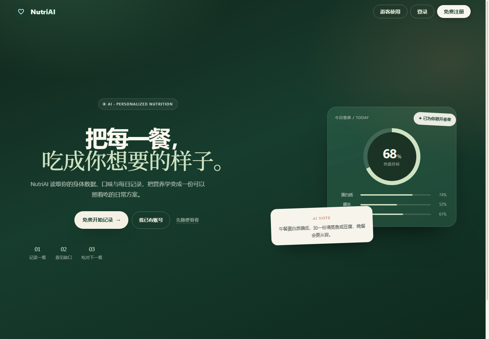
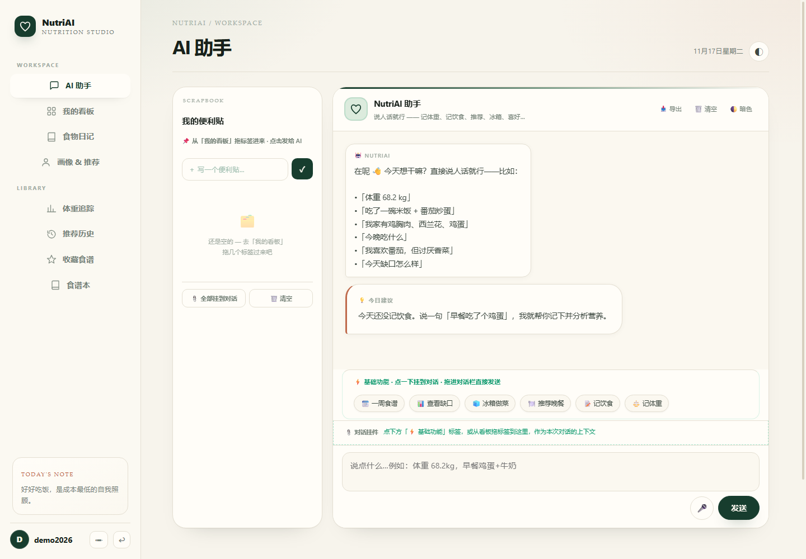
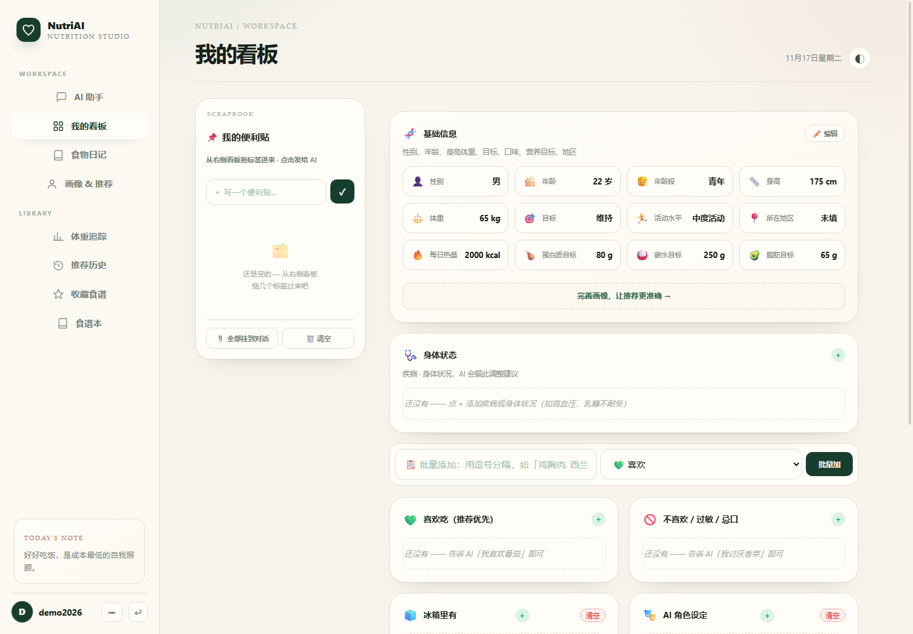
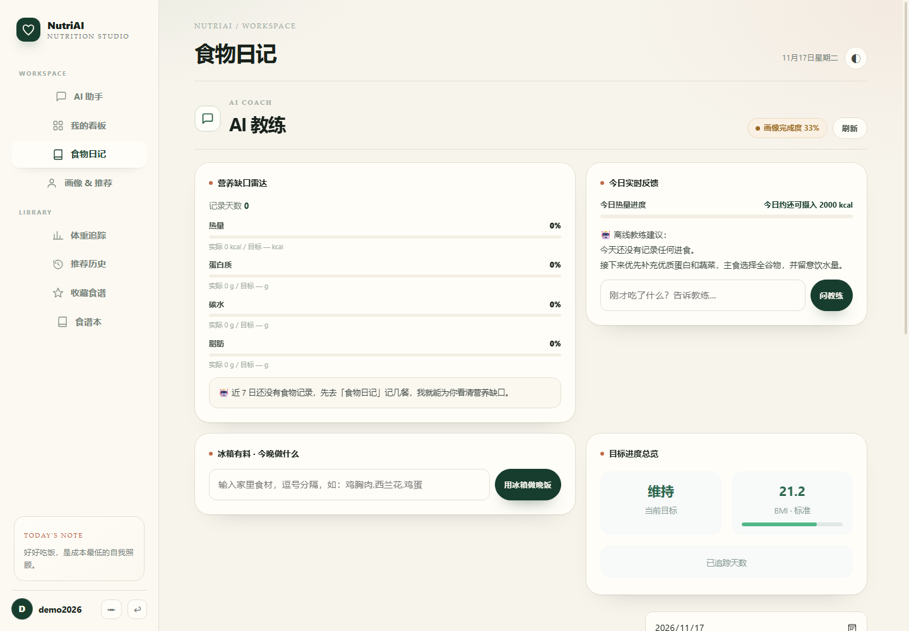
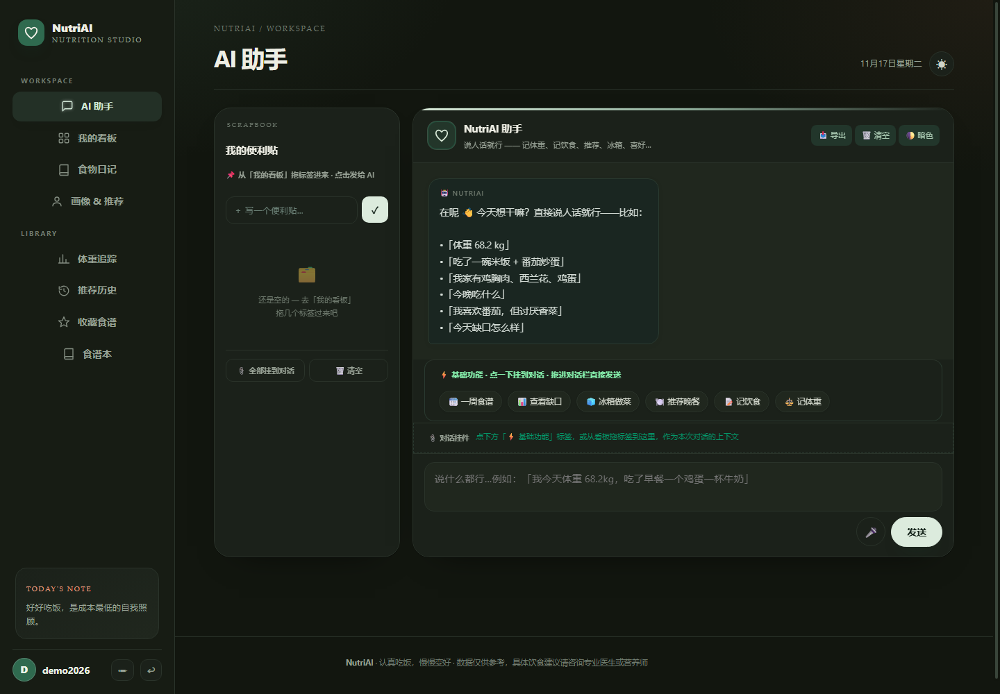
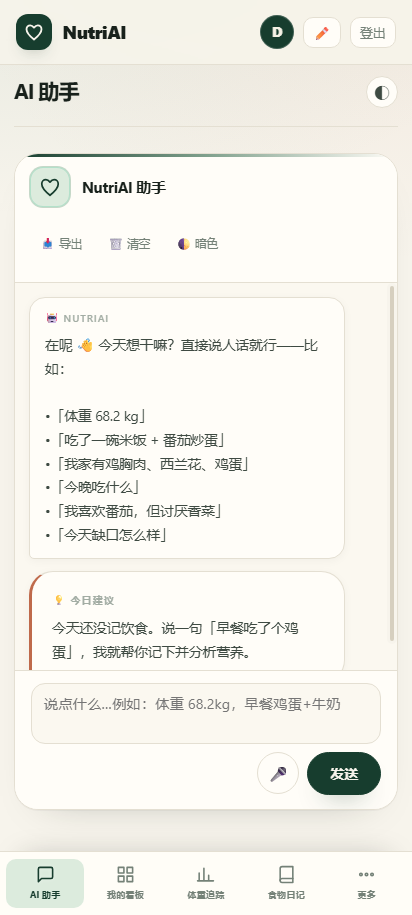

# NutriAI · 智能营养推荐系统

AI 驱动的个性化营养分析与饮食管理平台：记录饮食/体重、分析营养缺口、生成地域化食谱，并支持自然语言对话直接完成操作。

> 本项目使用 **Java 21 + Spring Boot 3.2 + MySQL 8**。2026 版已完成 **Editorial Wellness 视觉改版**：桌面侧边栏、移动端底部导航、可安装 PWA、深浅双主题、本地化的图表/Markdown 依赖。若不配置 AI Key，会自动进入离线演示模式（Mock AI）。

---

## 界面预览

| 首屏 | AI 助手 |
|------|---------|
|  |  |

| 我的看板 | 食物日记 |
|----------|----------|
|  |  |

| 深色模式 | 安卓端 |
|----------|--------|
|  |  |

> 更多截图见 `docs/screenshots/`；改版明细见 [docs/UI_REDESIGN_2026.md](docs/UI_REDESIGN_2026.md)；上线部署见 [deploy/README.md](deploy/README.md)。

---

## 快速开始

### 1. 环境要求

| 依赖 | 版本 / 路径 |
|------|-------------|
| JDK | **21**（本项目使用 `D:\java\21`） |
| Maven | 3.9+（也可直接用已构建好的 jar） |
| 数据库 | **MySQL 8**，本机 `localhost:3306` 已启动 |

MySQL 默认连接：`root / bingxin`，数据库 `nutriai`（不存在时会自动创建）。
如密码不同，请设置环境变量 `MYSQL_PASSWORD`，或修改 `application.yml` 默认值。

### 2. 一键启动

```bat
:: Windows
start.bat
```

脚本会：使用 Java 21 → 检查/构建 jar → 以 `mysql` 环境启动 → 自动打开浏览器。

也可手动启动：

```bat
cd backend
mvn clean package -DskipTests
java -jar target\nutri-ai-0.1.0.jar --spring.profiles.active=mysql --server.port=8080
```

访问 <http://localhost:8080>

### 3. 演示账号

| 用户名 | 密码 | 说明 |
|--------|------|------|
| `demo2026` | `NutriAI@123` | 首次连接空库时自动创建，含画像、3 天饮食、体重记录 |

> 演示数据只在 `nutriai` 库中没有 `demo2026` 时创建；如需重置，执行
> `DROP DATABASE nutriai;` 后重启服务（会自动重建表与演示数据）。

---

## 功能一览

- **AI 对话助手**：15 类意图识别（记体重、记饮食、冰箱、偏好、缺口、推荐、画像…），写入操作需确确认卡片。
- **便利贴看板**：喜欢 / 厌恶 / 冰箱 / AI 角色 / 营养缺口，可拖拽标签到左侧便利贴，点击直接发给 AI。
- **个性化推荐**：结合画像、地域、口味、近 7 天饮食与偏好，生成 2–4 道食谱（支持 SSE 流式与结构化两种展示）。
- **食物日记**：增删改查、按日期筛选、AI 食物识别、7 天营养汇总与达标率、CSV 导出。
- **体重追踪**：记录/删除、趋势折线图、统计（当前/变化/平均/最值）、CSV 导出。
- **AI 教练**：营养缺口雷达、今日实时反馈、冰箱有料推荐、目标进度。
- **推荐历史**：分页、关键词搜索、查看详情、删除。
- **收藏与食谱本**：收藏推荐食谱、查看详情、一键记入今日饮食。
- **账户体系**：注册即登录、用户名或邮箱登录、邮箱验证、找回密码（含重置页）。
- **PWA / 安卓适配**：可安装到主屏幕、离线壳、底部导航、安全区、触控优化。
- **双主题**：浅色 Editorial 纸质风 + 深色夜间版，支持记忆偏好。

---

## 运行环境（application.yml）

默认 profile 为 **mysql**，连接本机 MySQL 的 `nutriai` 数据库（不存在时自动创建）。

| Profile | 数据库 | 用途 |
|---------|--------|------|
| `mysql` | MySQL | 本地开发 / 演示（默认） |
| `prod` | MySQL + HikariCP | 生产部署 |

### 环境变量

| 变量 | 默认 | 说明 |
|------|------|------|
| `PORT` | `8080` | 服务端口 |
| `NUTRIAI_PROFILE` | `mysql` | 启动脚本使用的 profile（`mysql` / `prod`）；也可在 `.env.bat` 中设置 `SPRING_PROFILE` |
| `SPRING_PROFILE` | `mysql` | Spring profile；`start.bat` 固定默认 mysql，避免系统环境变量干扰 |
| `AI_API_KEY` | 空 → Mock | DeepSeek（OpenAI 兼容）API Key |
| `AI_API_ENDPOINT` | `https://api.deepseek.com/v1` | AI 接口地址 |
| `AI_MODEL` | `deepseek-chat` | 模型名 |
| `MYSQL_HOST` / `MYSQL_PORT` / `MYSQL_DB` | `localhost` / `3306` / `nutriai` | MySQL 连接 |
| `MYSQL_USER` / `MYSQL_PASSWORD` | `root` / `bingxin` | MySQL 账号（生产环境请用环境变量覆盖密码） |
| `MAIL_HOST` / `MAIL_PORT` | `smtp.qq.com` / `587` | SMTP |
| `MAIL_USERNAME` / `MAIL_PASSWORD` | 空 | 发件账号 |
| `APP_BASE_URL` | `http://localhost:8080` | 邮件中的站点地址 |
| `CORS_ORIGINS` | 空（仅同源） | 允许跨域的前端来源，逗号分隔 |
| `DEMO_DATA` | `true` | 库中无演示账号时是否自动创建 |

> 建议把 `AI_API_KEY` 放在系统环境变量或根目录 `.env.bat`（已在 .gitignore 中），不要写进脚本提交。

---

## 项目结构

```
NutriAI/
├── start.bat / start.ps1 / stop.bat     启动与停止脚本（Java 21）
├── README.md                            本文档
├── deploy/                              Windows / Linux 上线部署方案
│   ├── README.md                        部署手册（含 HTTPS、备份、安全清单）
│   ├── windows/                         计划任务服务化、备份脚本
│   └── linux/                           Docker Compose、Nginx、systemd
├── docs/reports/                        各周汇报 PPT 与草稿
├── docs/screenshots/                    2026 改版截图
├── PROJECT_NOTES.md                     历史开发笔记（周报与踩坑记录）
├── backend/
│   ├── pom.xml                          Spring Boot 3.2 + Java 21
│   ├── Dockerfile                       多阶段构建（非 root + 健康检查）
│   └── src/main/
│       ├── java/com/nutriai/
│       │   ├── ai/                      AI 抽象（DeepSeek / Mock）
│       │   ├── config/                  安全、CORS、演示数据
│       │   ├── controller/              REST API
│       │   ├── dto/                     请求/响应模型
│       │   ├── entity/                  JPA 实体
│       │   ├── repository/              Spring Data JPA
│       │   ├── service/                 业务逻辑
│       │   └── exception/               统一异常处理
│       └── resources/
│           ├── application.yml          mysql / prod 配置
│           ├── logback-spring.xml       控制台 + 生产滚动日志
│           ├── rag/                     膳食指南与食物营养库
│           └── static/
│               ├── index.html           单页应用
│               ├── css/                 设计系统 + Editorial 主题
│               ├── js/                  应用与 AI 助手逻辑
│               ├── vendor/              Chart.js / marked（本地化）
│               ├── icons/               PWA 图标
│               ├── manifest.json        PWA 清单
│               ├── sw.js                Service Worker
│               └── offline.html         离线页
└── backend/target/                      构建产物（git 忽略）
```

---

## 构建与测试

```bat
cd backend
mvn clean test        :: 单元测试
mvn clean package     :: 生成 jar（含测试）
```

当前测试覆盖：意图路由、体重/冰箱/偏好解析、认证、食物日记、体重追踪、便利贴同步等，共 **68 条**（含 4 组 MockMvc 集成测试）。

---

## 上线部署

完整步骤、HTTPS、备份与安全清单见 **[deploy/README.md](deploy/README.md)**。

| 场景 | 命令入口 |
|------|----------|
| 本机 Windows 长期运行 | `deploy/windows/install-service.ps1`（计划任务 + 开机自启 + 防火墙） |
| 云服务器 Docker | `deploy/linux/deploy.sh`（MySQL + App + Nginx + 健康检查） |
| 云服务器 systemd | `deploy/linux/systemd/nutriai.service` |

生产环境请务必：

- 使用独立 MySQL 账号与强密码，3306 不对公网开放
- 配置 HTTPS，并设置 `SESSION_COOKIE_SECURE=true`
- 关闭演示数据：`DEMO_DATA=false`
- 配置每日备份与 `/api/health` 监控

---

## 常见问题

**Q：启动报 “Communications link failure” / 连不上 MySQL？**
确认 MySQL 服务已启动、端口 3306 可访问，并检查 `MYSQL_USER` / `MYSQL_PASSWORD`。
默认使用 `root / bingxin`；密码不同请设置 `MYSQL_PASSWORD` 环境变量后重启。

**Q：忘记演示账号或数据乱了？**
停止服务，在 MySQL 中执行 `DROP DATABASE nutriai;` 后重启，应用会自动建库建表并写入演示数据。

**Q：AI 回复“离线演示模式”？**
未配置 `AI_API_KEY`。设置环境变量后重启即可；不配置也能使用记录、看板、图表等全部基础能力。

**Q：8080 端口被占用？**
`set PORT=8081` 后运行 `start.bat`，或使用 `stop.bat` 先结束旧进程。

**Q：前端改了 CSS/JS 不生效？**
静态文件打包在 jar 内，改完需重新 `mvn package` 并重启；浏览器可能仍在使用 Service Worker 缓存，强刷或清除站点数据即可。

**Q：手机上如何安装成 App？**
用 Android Chrome / Edge 打开站点，等待底部「安装」提示，或浏览器菜单选择「添加到主屏幕」。HTTPS 下体验最佳。

**Q：静态资源为什么要本地 vendor？**
Chart.js 与 marked 已放入 `static/vendor/`，不依赖公网 CDN，内网/弱网也能稳定出图与渲染 Markdown。

---

## 安全说明

- 会话 Cookie 为 `HttpOnly` + `SameSite=Lax`；生产建议同时开启 HTTPS 并设置 `SESSION_COOKIE_SECURE=true`。
- CORS 默认仅同源；确需跨域时通过 `CORS_ORIGINS` 显式配置。
- 所有 AI 输出在渲染前做 HTML 清洗，用户输入按纯文本处理，避免 XSS。
- 生产环境请为应用创建独立 MySQL 账号（仅授权 `nutriai` 库），不要使用 root。
- 请勿在仓库中提交真实 API Key、数据库密码或邮箱授权码。

---

## 免责声明

本项目所有营养数据与建议仅供参考，不能替代医生或注册营养师的专业诊断。
